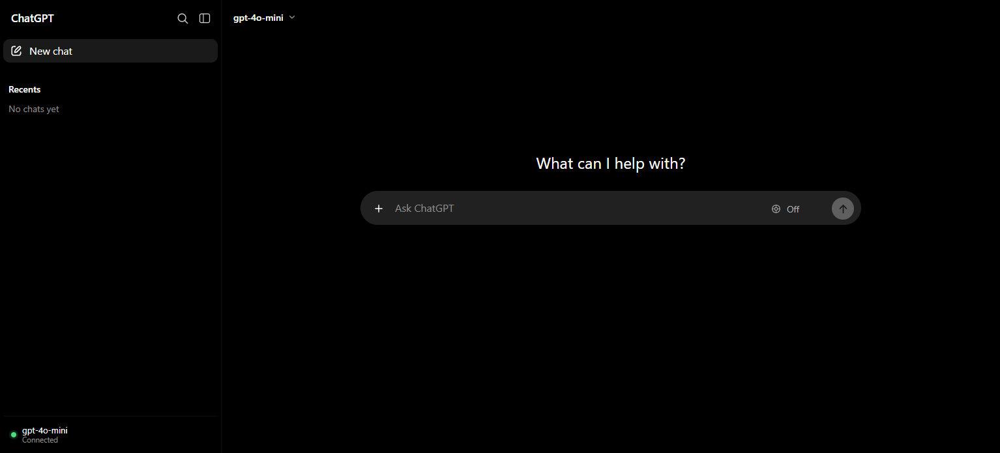
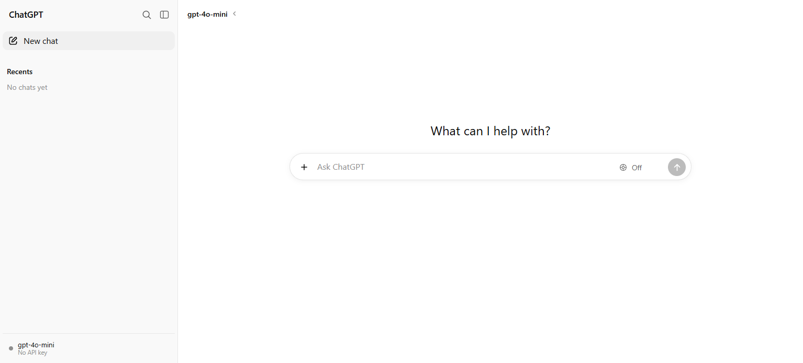
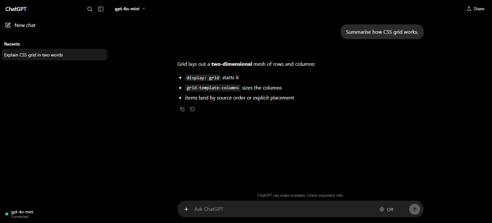
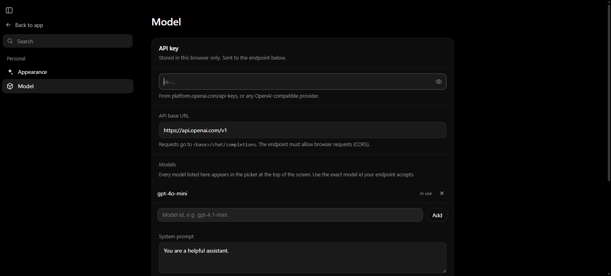
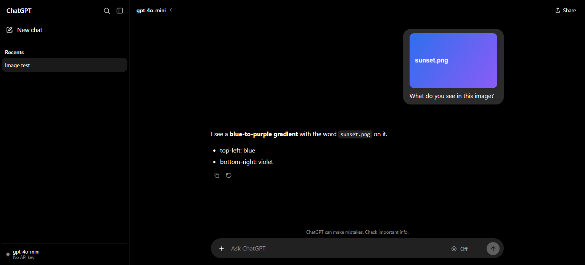
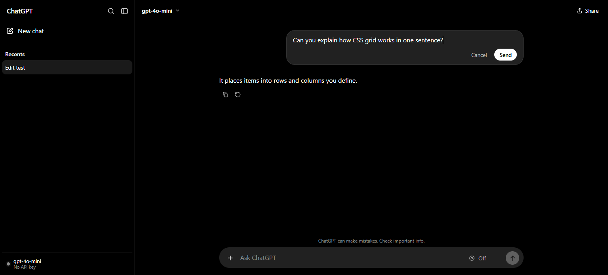

# ChatGPT UI — single-file clone

[](https://github.com/amirreza-anari/chatgpt-single-file/actions/workflows/verify.yml) [](LICENSE)

A replica of the ChatGPT web interface in **one HTML file**. No framework, no bundler, no CDN, no build step at runtime, no telemetry — open `index.html` in a browser and it runs. Bring your own OpenAI-compatible API key.

**Live demo:** https://amirreza-anari.github.io/chatgpt-single-file/ — same single file served by GitHub Pages. Your key stays in your own browser.

> **Unofficial.** This is an educational UI study, not affiliated with, endorsed by, or connected to OpenAI. "ChatGPT" and OpenAI's marks belong to OpenAI. No OpenAI code, assets or data are included — the interface was re-measured from screenshots of the signed-in web UI, and the icon geometry was redrawn in a local SVG sheet.

## Screenshots

| | |
|---|---|
| <br>Empty state (dark) | <br>Empty state (light) |
| <br>Conversation view | <br>Settings → Model |
| <br>Image attachment in a thread | <br>Editing a sent message |

Rendered at 1534×695 (the CSS size of 1917×869 captures at Windows 125% scaling).

## Quick start

1. Download `index.html` — that one file is the entire app.
2. Open it (double-click, or `file:///…/index.html`). Local `file://` works; no server needed.
3. Settings (gear icon) → **Model**: paste an API key and a base URL.
4. Chat. Threads and settings persist in this browser's `localStorage`.

### Endpoint notes

Requests go to `<base>/chat/completions`, so any OpenAI-compatible endpoint works:

| Endpoint | Base URL |
|---|---|
| OpenAI | `https://api.openai.com/v1` |
| OpenRouter | `https://openrouter.ai/api/v1` |
| Groq / Together / Fireworks | their `/v1` base |
| LM Studio / Ollama (local) | `http://localhost:1234/v1`, `http://localhost:11434/v1` |

The endpoint must allow browser (CORS) requests. OpenAI and most local servers do; a plain Anthropic API key does **not** work directly because `api.anthropic.com` refuses browser origins — proxy it or use an OpenAI-compatible gateway.

## Features

- **Streaming replies** — `fetch` + `ReadableStream`, incremental SSE/JSON chunk parsing, delta-by-delta painting throttled to ~30 fps, abortable mid-stream.
- **Markdown rendering** — headings, lists, tables, inline code, fenced code blocks with a language label and a per-block copy button; raw HTML is escaped.
- **Message actions** — edit a sent message (rewrites the thread from that point), regenerate, copy, timestamps.
- **Attachments** — text/code files and images, shown as removable chips; images are sent as data URLs.
- **Model picker** — top-of-composer picker with an inline menu ("Manage models…" jumps to settings); keep several model ids and mark one in use.
- **Settings panel** — Appearance (theme) and Model panes: API key (masked, reveal toggle), base URL, model list, temperature, max tokens, system prompt, thinking level (off/low/medium/high), and a **Test connection** button that probes the exact payload a real message sends.
- **Chat search** — overlay search across every stored thread.
- **Sidebar** — recents list, new chat, collapse to an icon rail; off-canvas on narrow widths.
- **Chat management** — export the current thread to Markdown, clear all chats, jump-to-bottom button.
- **Theming** — dark/light measured from the real UI's tokens, plus `prefers-reduced-motion` support.
- **Single-file purity** — zero external `http(s)` asset references, no `@import`, no `<script src>`; enforced by the verifier.

### Keyboard shortcuts

| Keys | Action |
|---|---|
| `Ctrl/⌘ + K` | Focus the composer (opens the sidebar first on narrow widths) |
| `Ctrl/⌘ + B` | Collapse/expand the sidebar |
| `Ctrl/⌘ + Shift + O` | New chat |
| `Ctrl/⌘ + Enter` | Send from anywhere on the page |
| `Esc` | Close search / settings / menus |

## Repo layout

```
index.html                  the entire app (generated — do not hand-edit)
build/_shell.html           all markup, CSS and the inline <symbol> icon sheet
build/_engine.js            all app JavaScript
build/_sprite.svg           icon geometry source (already inlined into the sheet)
build/rebuild.py            concatenates the two sources into index.html
build/verify.py             rebuild + structural/purity checks
.github/workflows/verify.yml  CI: rebuild, verify, and fail if index.html drifts from sources
preview/                    the screenshots above
legacy/                     first-attempt prototype and its unused asset, kept for reference
```

## Rebuilding (only needed if you edit the sources)

```bash
python build/rebuild.py    # -> index.html
python build/verify.py     # rebuild, then check
```

Requires Python 3 and Node (the verifier runs `node --check` on the engine). `verify.py` fails loudly on source drift: a `$("id")` in the engine with no matching element, unbalanced CSS braces, a JS syntax error, a leftover stub control, or an external asset reference that would break the one-file rule. CI runs the same script on every push and pull request, then `git diff --exit-code index.html` so a commit that forgets to rebuild fails instead of silently shipping a stale file.

## Privacy

The API key lives only in this browser's `localStorage` and is sent only to the endpoint you configure. There is no analytics, no third-party request, and no backend of any kind — the verifier exists specifically to keep the file free of external references.

## Known limits

- The chat surface was verified in headless Chrome at desktop width; there are media queries at ≤820 px and ≤900 px but the layout has not been tested on a real phone.
- `build/verify.py` is the only automated check (structure, source/index consistency, single-file purity) — there is no behavioural test suite; CI runs the verifier, not the UI.
- A full generate → stream round-trip needs your own API key, so it is not exercised by the checks above.
- Not implemented: voice mode, projects, canvas, temporary chats, mid-thread model switching, file uploads other than text/image.

## License

MIT — see [LICENSE](LICENSE).
